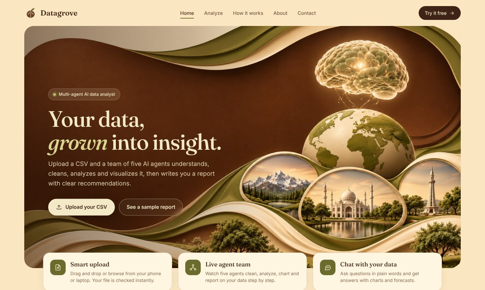
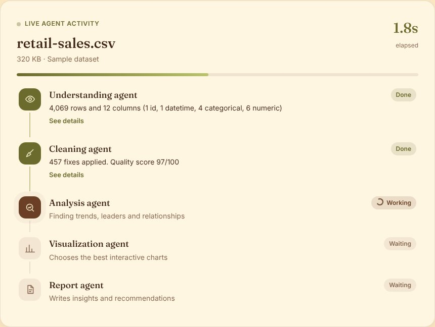
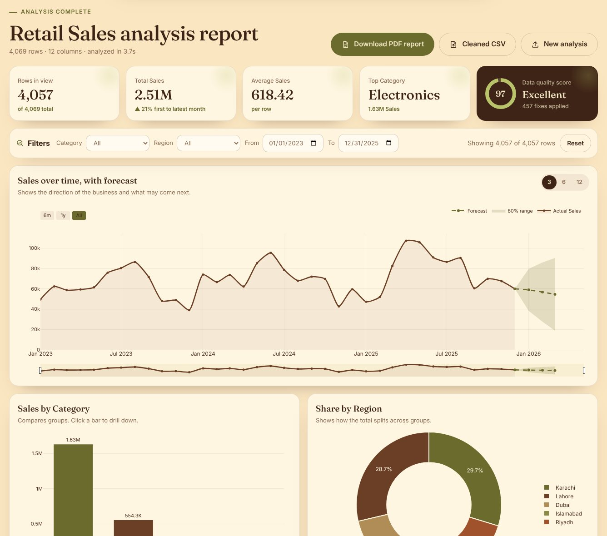
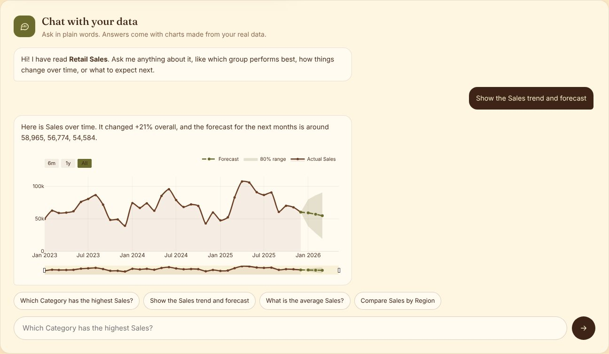
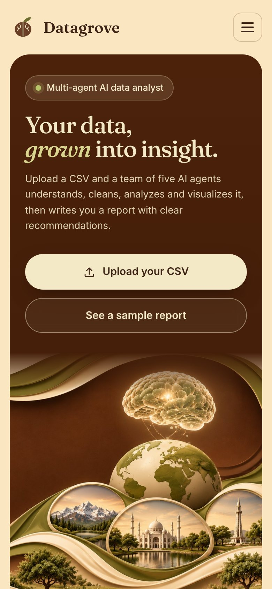

<div align="center">


# Datagrove — AI Data Analyst Agent

**Your data, grown into insight.**
Upload a CSV and a team of five AI agents understands, cleans, analyzes and visualizes it, then writes a report with insights, a forecast and recommendations.

[**Live demo →**](https://datagrove-ai.vercel.app) &nbsp;·&nbsp; [Try a sample](https://datagrove-ai.vercel.app/analyze?sample=retail) &nbsp;·&nbsp; [How it works](https://datagrove-ai.vercel.app/how-it-works)




</div>

---

## What it does

Most small businesses have useful data sitting in spreadsheets, but no time or team to analyze it. Datagrove gives them an **AI analytics team** that turns a raw CSV into a clear, shareable report in under a minute.

| | Feature | Details |
|---|---|---|
| 📤 | **Smart CSV upload** | Drag and drop or browse on phone and laptop. Auto-detects delimiter and encoding. Large files are sampled evenly in the browser. |
| 🤖 | **Live agent activity** | Watch all five agents work in real time (streamed from the backend), with expandable details for each step. |
| 📊 | **Interactive visual analytics** | Hover, filters, date range, zoom, range slider and click-to-drill-down. Every chart recalculates instantly from the exact data. |
| 📈 | **Forecasting** | Holt's linear trend forecast for the next 3, 6 or 12 periods with an 80% confidence band. |
| 💬 | **Chat with your data** | Ask questions in plain words. Answers come with charts computed from the real rows, so numbers are always exact. |
| 🧠 | **AI insights and recommendations** | An executive summary, five insights and four practical recommendations, written by Google Gemini from the real findings. |
| 📄 | **Downloadable report** | A polished multi-page PDF (summary, KPIs, insights, recommendations, charts, cleaning log) plus the cleaned CSV. |
| ✉️ | **Contact form** | Messages are emailed directly to the site owner. |

## The five agents

```
 CSV ─▶ ① Understanding ─▶ ② Cleaning ─▶ ③ Analysis ─▶ ④ Visualization ─▶ ⑤ Report ─▶ Dashboard + PDF
```

| Agent | Responsibility |
|---|---|
| **① Understanding** | Parses the file, classifies every column (date, number, category, text, ID) and picks the main business metric. |
| **② Cleaning** | Removes empty rows and duplicates, fixes messy text (`"lahore "` → `"Lahore"`), converts number-like text and dates, fills missing values, flags outliers, and scores data quality from 0 to 100. |
| **③ Analysis** | KPIs, growth over time, best and worst periods, group leaders, correlations, distributions and a forecast. |
| **④ Visualization** | Chooses the right charts for the data (trend + forecast, drill-down bars, donut, histogram, scatter, correlation heatmap) and prepares a compact dataset for the browser. |
| **⑤ Report** | Writes the executive summary, insights and recommendations with Gemini. Falls back to a careful rule-based writer if no API key is set, so a report is always produced. |

## Screenshots

| Live agent activity | Interactive dashboard |
|---|---|
|  |  |

| Chat with your data | Mobile |
|---|---|
|  |  |

## Tech stack

- **Backend:** Python, FastAPI, pandas, NumPy, streaming NDJSON responses
- **AI:** Google Gemini (`gemini-3.8-flash`, with automatic fallback to newer models) through the REST API
- **Frontend:** HTML, CSS and vanilla JavaScript, Plotly.js, jsPDF, self-hosted Fraunces and Inter fonts
- **Hosting:** Vercel (static pages + Python serverless function)
- **Design:** custom Olive, Buttercream and Walnut theme, fully responsive for mobile, tablet and desktop

## Project structure

```
datagrove-ai-analyst/
├── api/
│   └── index.py              # FastAPI app: /api/analyze, /api/chat, /api/contact, /api/health
├── backend/
│   ├── agents/
│   │   ├── understanding.py  # ① file parsing + column types + main metric
│   │   ├── cleaning.py       # ② cleaning log + data quality score
│   │   ├── analysis.py       # ③ KPIs, trends, breakdowns, correlations, forecast
│   │   ├── visualization.py  # ④ chart plan + compact data for the browser
│   │   └── report.py         # ⑤ AI report with rule-based fallback
│   ├── pipeline.py           # orchestrator that streams agent progress
│   ├── chat.py               # chat with your data (answer + chart spec)
│   ├── contact.py            # contact form email
│   └── llm.py                # lightweight Gemini client
├── assets/                   # css, js, fonts, images, vendor libraries
├── samples/                  # demo datasets (retail sales, coffee shop)
├── index.html  analyze.html  how-it-works.html  about.html  contact.html
├── requirements.txt
└── vercel.json
```

## API

| Method | Route | Description |
|---|---|---|
| `GET` | `/api/health` | Service status and AI mode |
| `POST` | `/api/analyze` | Multipart CSV upload. Streams one JSON event per line for each agent, then the full result. |
| `POST` | `/api/chat` | `{ question, context, history }` → `{ answer, chart }` |
| `POST` | `/api/contact` | `{ name, email, subject, message }` → sends an email |

Interactive API docs are available at `/api/docs`.

## Run locally

```bash
git clone https://github.com/NimrahImran/datagrove-ai-analyst.git
cd datagrove-ai-analyst
pip install -r requirements.txt uvicorn
cp .env.example .env          # add your keys
npm i -g vercel && vercel dev  # serves the pages and the API together
```

## Environment variables

| Name | Required | Purpose |
|---|---|---|
| `GEMINI_API_KEY` | Recommended | Google Gemini key for AI insights and chat (free key from Google AI Studio) |
| `GEMINI_MODEL` | Optional | Override the model (default `gemini-3.8-flash`) |
| `GMAIL_USER` | For contact form | Gmail address that sends contact emails |
| `GMAIL_APP_PASSWORD` | For contact form | Google App Password for that address |
| `CONTACT_TO` | Optional | Where contact messages are delivered (defaults to `GMAIL_USER`) |

## Privacy

Uploaded files are processed in memory and are never stored.

---

<div align="center">

**Built by Nimra Imran** · AI Engineer

</div>
